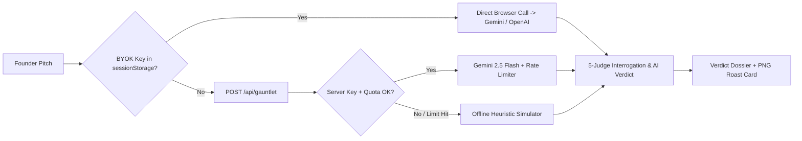

# The Gauntlet — Adversarial AI Pitch Simulator

Test your startup pitch against **five ruthless buyer archetypes** before real customers say no. Built with Next.js 16, TypeScript, Tailwind CSS v4, Direct-Browser BYOK (Gemini / OpenAI), rate-limited Free Live AI, and a zero-dependency offline heuristic engine.

[**Try Live — gauntlet.berkaysahin.net**](https://gauntlet.berkaysahin.net) • [**Case Study — berkaysahin.net**](https://berkaysahin.net) • [**Report Bug / Request Persona**](https://github.com/berkaysahin-dev/shark-tank-gauntlet/issues)

[](https://vercel.com/new/clone?repository-url=https%3A%2F%2Fgithub.com%2Fberkaysahin-dev%2Fshark-tank-gauntlet)
[](LICENSE)
[](https://nextjs.org/)
[](https://www.typescriptlang.org/)
[](https://tailwindcss.com/)


---

## Why The Gauntlet?

Friends, mentors, and standard AI chatbots are too polite. They say *"Sounds great!"* when real buyers are silently thinking *"Why wouldn't an intern just do this in Excel?"* or *"Our security team will block this in 10 seconds."*

**The Gauntlet** puts your startup pitch in front of five adversarial buyer personas who actively look for reasons to walk out—forcing you to defend your ROI, data retention, onboarding friction, switching wedge, and long-term habit loop.

---

## Key Features

- **5 Ruthless Psychological Buyer Archetypes:** Each judge attacks a different real-world deal killer.
- **Direct-Browser BYOK (Zero Server Key Exposure):** Enter your own Gemini or OpenAI API key and requests go **straight from your browser** to Google/OpenAI (`sessionStorage` only, purged when the tab closes).
- **Rate-Limited Free Live AI + Circuit Breaker:** Optional server-side Gemini 2.5 Flash mode with per-IP daily quotas and a global daily cap (Upstash Redis or in-memory fallback).
- **Zero-Setup Offline Simulator:** Works instantaneously with zero keys via a negation-aware bilingual heuristic engine.
- **Downloadable PNG Roast Card:** Export a `1200×630` social-ready scorecard featuring your final conviction %, per-judge bars, and harshest quote to share on X or LinkedIn.
- **Bilingual (`EN` / `TR`) & Light/Dark Theme:** Instant switching across all UI, personas, and verdicts.

---

## The Five Buyer Archetypes

| Judge (EN / TR) | Archetype | What Breaks the Deal | How to Win Them Over |
| :--- | :--- | :--- | :--- |
| **Arthur Vance / Halis Bey** | The Penny-Pincher | Buzzwords (*"future of AI"*, *"cost of a coffee"*) | Concrete payroll hours saved & 30-day payback math |
| **Marcus Vance / Bülent Demir** | The Security Gatekeeper | *"Don't worry, we host on AWS"* | Zero-retention policy, client-side encryption, VPC / compliance |
| **Sarah Jenkins / Aslı Karaca** | The Busy Operator | *"Watch our 20-minute onboarding webinar"* | Runs inside Slack/email/existing workflow with 1-click setup |
| **David Sterling / Mert Vural** | The Market Leader Fan | *"We're cheaper and have 50 features"* | 10x wedge on one painful bottleneck + 1-click migration |
| **Elena Gomez / Ece Tezel** | The Quick-to-Bore Buyer | *"We send daily push notifications"* | Passive ambient value (e.g., morning digest without logging in) |

---

## Architecture & Execution Modes



| Mode | Where API Key Lives | Server Sees Your Key? | Cost / Limits |
| :--- | :--- | :--- | :--- |
| **Direct-Browser BYOK** | Browser `sessionStorage` only | **Never** | Unlimited (your own Gemini/OpenAI key) |
| **Free Live AI** | Server `.env` (`GEMINI_API_KEY`) | Server-side only | Protected by per-IP & global daily caps |
| **Offline Simulator** | None required | N/A | Unlimited, instant, zero network dependency |

---

## Quick Start

### Prerequisites
- Node.js 18+ or 20+
- npm, pnpm, or yarn

### Run Locally

```bash
git clone https://github.com/berkaysahin-dev/shark-tank-gauntlet.git
cd shark-tank-gauntlet
npm install
npm run dev
```

Open [http://localhost:3000](http://localhost:3000). To enable optional server-sponsored Free Live AI, copy `.env.example` to `.env.local` and configure `GEMINI_API_KEY` (plus optional `UPSTASH_REDIS_REST_URL` and `UPSTASH_REDIS_REST_TOKEN` for distributed rate limiting).

---

## Security & Privacy

The Gauntlet enforces strict zero-retention defaults for confidential startup ideas:
- Direct-Browser BYOK never sends user API keys through our backend.
- Prompt inputs are sanitized and wrapped in delimiter-escape-resistant quarantine blocks (`src/lib/security.ts`).
- Production CSP disables `'unsafe-eval'`, blocks framing (`X-Frame-Options: DENY`), and restricts outbound `connect-src` exclusively to `'self'`, Google Gemini, and OpenAI.

See [SECURITY.md](SECURITY.md) for full details and responsible disclosure.

---

## Contributing: Add a New Buyer Persona

Contributions are very welcome! Adding a new buyer archetype takes less than 10 minutes:

1. Open `src/config/personas.ts` and add a new `JurorConfig` entry (`id`, EN/TR names, motto, `fatalTrigger`, `persuasionKey`).
2. Add matching offline heuristic rules in `src/lib/simulation.ts` and quick-reply tactics in `src/components/BoardroomArena.tsx`.
3. Verify with `npm run build` and open a Pull Request.

---

## License

Licensed under the [MIT License](LICENSE).

---

## Disclaimer

The Gauntlet is an independent open-source project by [Berkay Şahin](https://berkaysahin.net). It is not affiliated with, endorsed by, or connected to *Shark Tank*, *Dragons' Den*, Sony Pictures Television, or any of their cast or producers.
